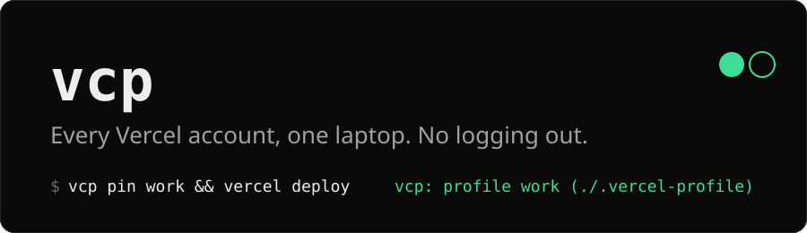

<p align="center"></p>

<p align="center">
  <a href="https://github.com/ArinPrajapati/vcp/actions/workflows/ci.yml"></a>
  <a href="LICENSE"></a>
  
  
</p>

**vcp** lets you use as many personal Vercel accounts as you need on one machine, without logging out and back in. It is not for teams or orgs: the Vercel CLI already handles those. This is for the case where you are *several different users*, for example a personal account and a client or employer account.

```sh
vcp pin work          # this repo belongs to "work"
vercel deploy         # deploys as "work", from any subdirectory
cd ../side-project
vercel deploy         # deploys as your default profile
```

## Why

The Vercel CLI keeps one login in one folder. Switching accounts means `vercel logout` and `vercel login` every time, and the one time you forget, you deploy to the wrong account. vcp gives every account its own login folder and picks the right one for you, based on the directory you are in.

## Who it is for

vcp helps when you are **more than one Vercel user on one machine**, not one user in two teams. The common cases:

| Scenario | The problem | With vcp |
| --- | --- | --- |
| **Day job + side projects** | Work has its own Vercel account (company email); your side projects live on your personal one. One slip and a hobby app lands in the company account, or the reverse. | Pin the work repos to `work`. Everything else uses `personal`. |
| **Freelancers and consultants** | Several clients each own a Vercel account and gave you a login rather than inviting you to a team. | One profile per client. `cd` into the client's repo and you are already logged in as them. |
| **Open-source maintainers** | A personal account plus a separate account that owns a project's site or docs. | Keep the project's repos pinned to the project account. |
| **Strict production separation** | Company policy keeps production on a different account from staging or experiments. | Pin each repo to the account that owns it. A deploy can only go where the pin says. |
| **Demos, talks and streams** | You want a clean account on screen, without your personal projects in the dashboard or `vercel ls`. | `VERCEL_PROFILE=demo vercel ...` in that terminal only. |
| **AI coding agents** | Agents run `vercel` in many repos. Without profiles they use whichever account was logged in last. | Pins make every agent run in a repo hit the right account, and the stderr line shows which. |

### When you do not need it

- **You have one Vercel account.** Nothing to switch.
- **You are one user in several teams.** Use the CLI's own `vercel switch` or `--scope`. Teams share a single login, so this is not vcp's job.
- **CI.** Use a project token in `VERCEL_TOKEN`. vcp steps aside when it sees one.

## Install

```sh
curl -fsSL https://raw.githubusercontent.com/ArinPrajapati/vcp/main/install.sh | sh
```

Or clone and run `./install.sh`. Read it first if you like: it is about 60 lines, clones this repo to `~/.config/vcp`, and adds one marked block to your `~/.zshrc`, `~/.zshenv`, `~/.bashrc` and `~/.bash_profile` (only those that exist). You need the real Vercel CLI (`npm i -g vercel` or `pnpm i -g vercel`) and `git`. fish users: `fish_add_path -m ~/.config/vcp/bin`.

Open a new terminal, then:

```sh
vcp import personal    # adopt the Vercel login you already have
vcp add work           # log in another account (opens the browser); add as many as you need
vcp doctor             # checks PATH, profiles and logins
```

When the browser opens for `vcp add`, sign in with the account you want for that profile. If your browser is already signed in to the other account, use a private window.

## Everyday use

| Command | What it does |
| --- | --- |
| `vcp ls` | List profiles (`*` marks the one in effect) |
| `vcp current` | Show the profile in effect and why |
| `vcp whoami` | Ask Vercel which user that profile is |
| `vcp use <name>` | Set the global default |
| `vcp pin [name]` | Pin the current directory tree to a profile (writes `.vercel-profile`) |
| `vcp unpin` | Remove that pin |
| `vcp as <name> <args>` | Run one command as another profile, e.g. `vcp as work whoami` |
| `vcp add <name>` | Create a profile and log in |
| `vcp import <name>` | Copy your existing Vercel login into a profile |
| `vcp rm <name>` | Delete a profile and its login |
| `vcp prompt` | Print just the profile name, for your shell prompt |
| `vcp doctor` | Check the setup |

`vercel` and `vc` work exactly as before. Deploy-like commands (`deploy`, `link`, `env`, `domains`, `--prod`, ...) print `vcp: profile work (/path/.vercel-profile)` to stderr so you always see which account is acting. Set `VCP_QUIET=1` to silence it.

## How it works

Every profile is a folder in `~/.vercel-profiles/<name>/` holding the CLI's own `auth.json` and `config.json`. The Vercel CLI already supports `--global-config <dir>` to use a different folder. vcp puts shims called `vercel` and `vc` first on your PATH; they pick a profile, add that flag, and `exec` the real CLI. There is no daemon, no patching, and no extra network calls.

The profile is chosen by the first of these that exists:

1. `$VERCEL_PROFILE`, to change one terminal only: `VERCEL_PROFILE=work vercel whoami`
2. The nearest `.vercel-profile` file, searched upward from the current directory
3. The global default set by `vcp use`

If you pass `--token`, `-Q`/`--global-config`, or set `VERCEL_TOKEN`, vcp steps aside and does not touch your command. That keeps CI working unchanged.

## Gotchas

- **Project links belong to an account.** `.vercel/project.json` in a repo refers to a project owned by whichever account ran `vercel link`. Run the repo under the profile that owns it (`vcp pin`), or you will see "project not found" or a scope error.
- **Your existing login is not touched.** `vcp import` copies it. The original stays where the CLI put it.
- **Tokens stay on your machine.** Profile folders are mode 700 and `auth.json` is mode 600, same as the Vercel CLI. vcp never reads or prints tokens, and has no telemetry.
- **`.vercel-profile` is a plain name**, not a secret. Commit it only if everyone on the team uses the same profile names; otherwise add it to `.gitignore`.
- Works on macOS and Linux with `sh`. Windows is not supported (WSL works).

## Use with coding agents

Because the shims are real executables on PATH, agents and scripts get the same profile selection as your terminal. Agents should run `vcp current` before any link, deploy or env change. A ready-made Claude Code skill is in [`skills/vercel-profiles`](skills/vercel-profiles/SKILL.md); copy it to `~/.claude/skills/`.

## Uninstall

```sh
~/.config/vcp/uninstall.sh            # removes the PATH blocks, keeps your logins
~/.config/vcp/uninstall.sh --purge    # also deletes ~/.vercel-profiles
```

## Development

```sh
sh test/test.sh                                          # fake vercel, no network, no real login
shellcheck bin/vcp test/test.sh install.sh uninstall.sh
```

See [CONTRIBUTING.md](CONTRIBUTING.md). MIT licensed. Not affiliated with Vercel.
